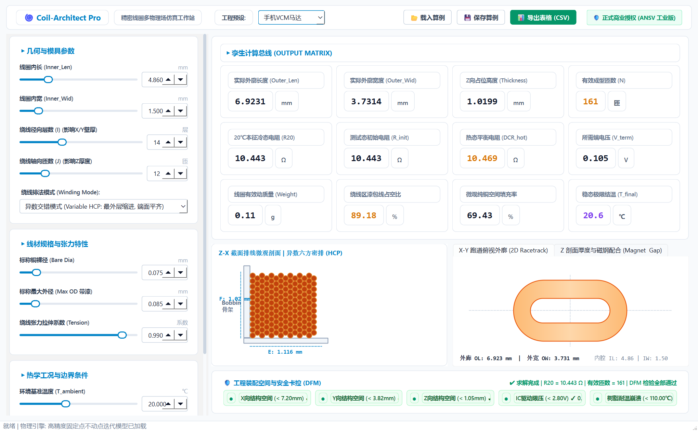
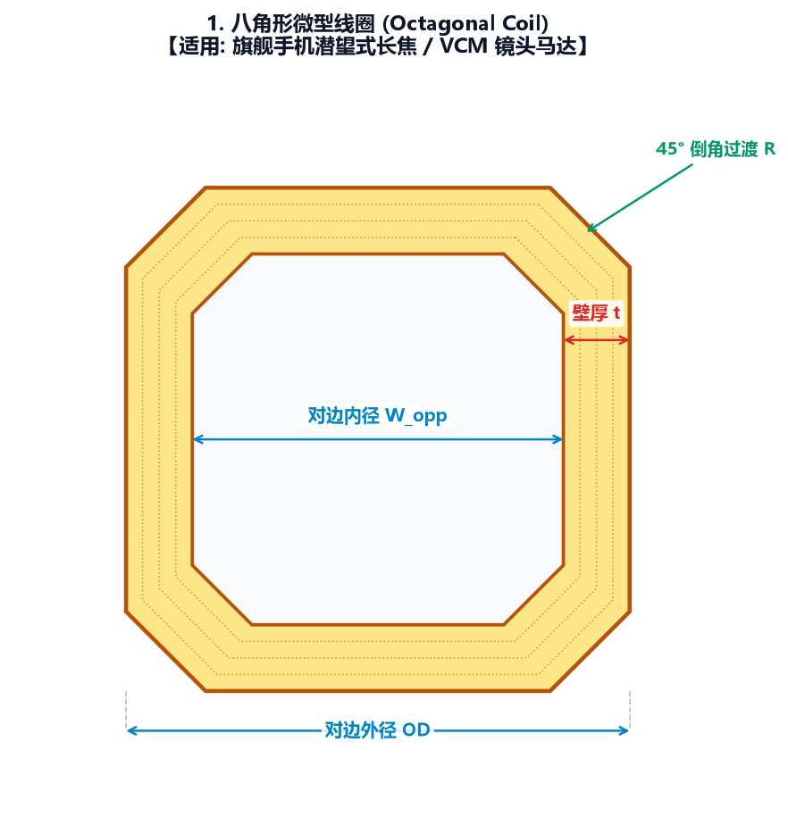
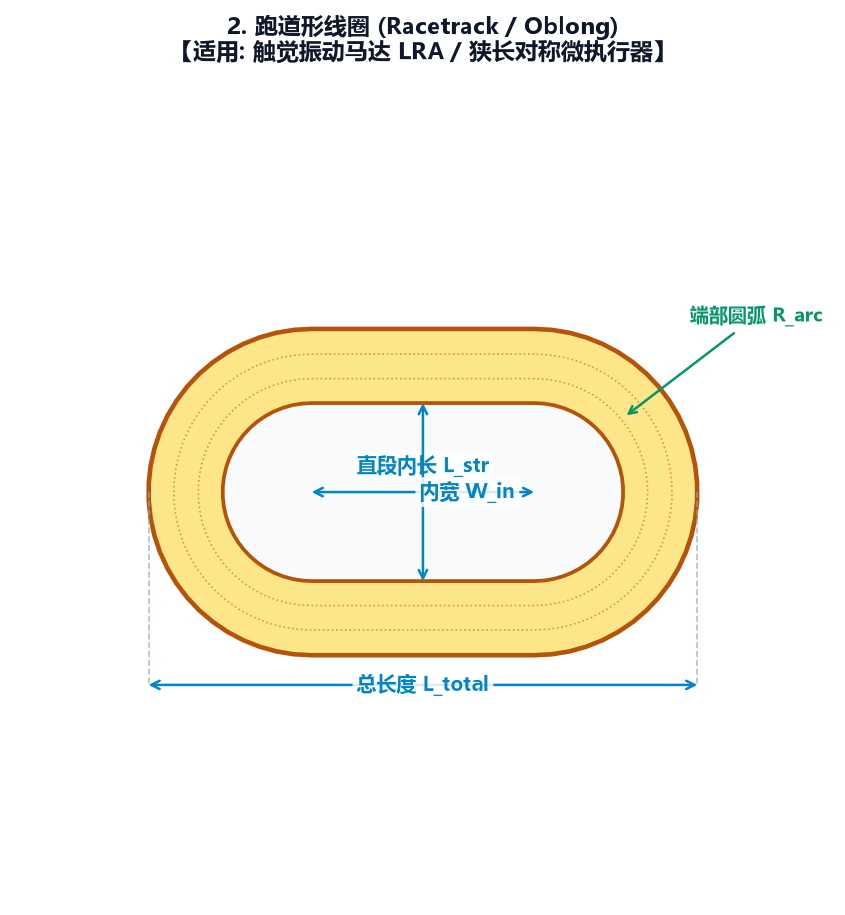
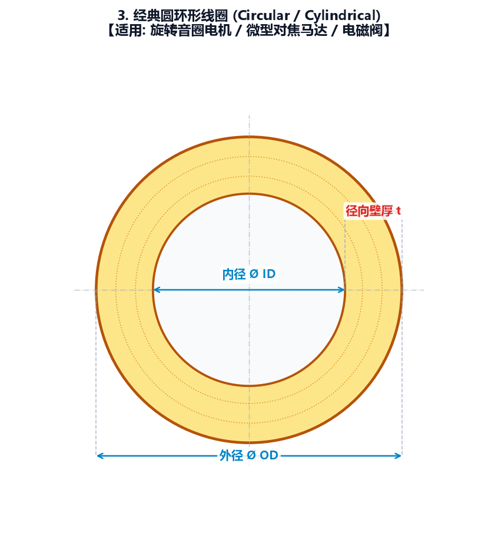
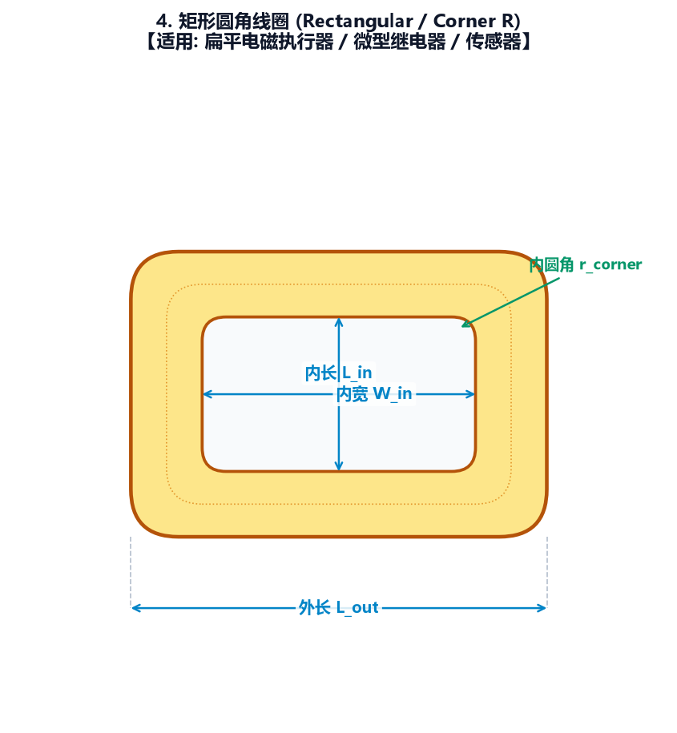
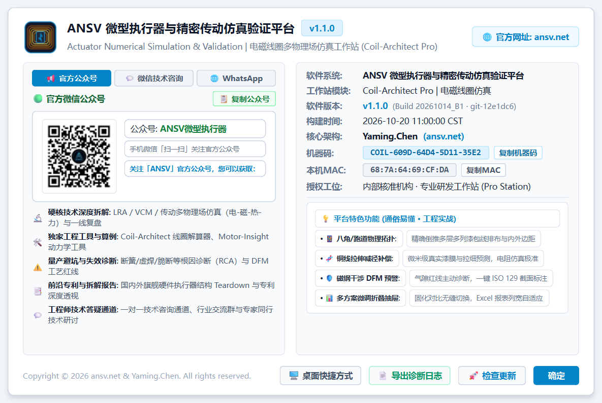

<div align="center">

# ⚡ ANSV Coil-Architect Pro | 电磁线圈多物理场仿真工作站
### Actuator Numerical Simulation & Validation | Industrial Micro-Coil Topology & Multiphysics CAE Platform (v1.1.0)

[](https://github.com/tonychen5577-tech/coil-architect/releases)
[-0284C7?style=flat-square&logo=windows)](https://github.com/tonychen5577-tech/coil-architect)
[](https://github.com/tonychen5577-tech/coil-architect)
[](https://github.com/tonychen5577-tech/coil-architect)
[](https://ansv.net)

<p align="center">
  <b>专为手机摄像头模组 (VCM)、微型执行器 (LRA/触觉马达)、精密电磁阀及传动系统量身打造的高精度电磁线圈多物理场仿真与 DFM 工程化工作站</b>
</p>

[📥 软件下载与部署](#-软件下载与部署) • [🌀 支持的线圈形态与应用矩阵](#-支持的四大微型电磁线圈形态与工程应用矩阵) • [✨ 核心功能亮点](#-核心功能亮点) • [🛡️ 磁钢气隙 DFM 红线与 ISO 标注](#-磁钢气隙装配-dfm-工艺红线与-iso-129-标注) • [📊 多方案微调对比抽屉](#-多方案微调数据对比抽屉与-excel-自适应导出) • [🔑 商业授权与订阅模式](#-软件授权与订阅模式) • [📬 专属联系通道](#-技术支持与专属联系通道)

</div>

---

## 📖 系统简介 (System Overview)

**Coil-Architect Pro** 是 **ANSV 微型执行器与精密传动仿真验证平台 (Actuator Numerical Simulation & Validation)** 旗下的核心电磁线圈求解器工作站。

在高端智能手机潜望镜头、微型音圈电机 (VCM)、线性振动马达 (LRA) 以及精密医疗执行器设计中，线圈通常被严苛限制在毫米乃至微米级的极窄装配腔体内。传统线圈排布过度依赖工程师的**“经验查表与手工盲目试凑”**，面临**对角干涉严重、铜线拉伸减径偏差大、真实漆膜厚度失真、常温/工作温升电阻超标、打样试产报废率高**等行业痛点。

Coil-Architect Pro 深度整合了**异形微型线圈几何拓扑解析、张力拉伸减径物理补偿、微米级自粘漆包绝缘膜精算、电-磁-热多物理场耦合与磁钢气隙 DFM 制造干涉预警**：

输入装配腔体约束与目标电阻，系统内置的高性能专用求解内核可在毫秒级内自动反演倒推出最佳绕线层数、圈数排布、内外径几何链、成型厚度与真实热态阻值，并一键输出符合 **ISO 129** 国际标准的工程截面投影图与自适应排版评审报表，为微型执行器的敏捷研发与量产直通率保驾护航。

<p align="center">
  
  <br>
  <em>图 1：ANSV Coil-Architect Pro 工作站主界面 —— 微型执行器多物理场参数解算与排线截面实时渲染</em>
</p>

---

## 🌀 支持的四大微型电磁线圈形态与工程应用矩阵

为了满足微型执行器多样化极限装配空间的需求，Coil-Architect Pro 原生支持工业界主流的 **4 大类线圈几何拓扑**，涵盖从旗舰潜望模组到超薄触觉马达的全场景仿真与工艺验证：

<p align="center">
  
  <br>
  <em>图 2：Coil-Architect Pro 原生支持的 4 大主流微型电磁线圈工业形态与拓扑全景</em>
</p>

<br>

### 1. 🌟 八角形微型线圈 (Octagonal Micro-Coil)
<table width="100%">
<tr>
<td width="38%" align="center">
  
</td>
<td width="62%" valign="top">

- **典型工程应用**：
  - 智能手机 50MP / 200MP 旗舰潜望式变焦与连续光学变焦镜头模组；
  - 闭环自动对焦 (Closed-loop AF) 与五轴悬丝/滚珠光学防抖 (OIS) 音圈马达 (VCM)；
  - 潜望折转棱镜双向微型电磁偏转执行器。
- **几何特征与拓扑定义**：
  - 八边等宽严格对称约束，支持**对边内径 (Opposite Flat)** 与**对角内径 (Corner Diagonal)** 独立控制；
  - $135^\circ$ 钝角转角过渡，内置自适应内圆角排线半径；
  - 多层正六边形最密排布 (Hexagonal Close Packing) 跨边同心膨胀算法。
- **仿真解决的核心痛点**：
  - 彻底攻克八角拐弯处四角外径向外鼓胀导致的马达磁钢刮碰与掉粉短路；
  - 毫秒级闭式逆向反演最佳导体线径与圈数，省去反复打样测试成本。

</td>
</tr>
</table>

### 2. 🚀 跑道形线圈 (Racetrack Coil)
<table width="100%">
<tr>
<td width="38%" align="center">
  
</td>
<td width="62%" valign="top">

- **典型工程应用**：
  - 智能手机与高品质平板电脑 X 轴线性振动马达 (X-axis LRA)；
  - 游戏手柄宽频宽动态触觉反馈致动器 (Haptic Actuator)；
  - 超薄手机受话器 (Receiver) 与微型微缝扬声器驱动音圈；
  - 医疗便携微流控推杆与微型电磁泵。
- **几何特征与拓扑定义**：
  - 双平行直线段长边 + 双端相切平滑半圆弧；
  - 直线段跨度长度 ($L$) 与半圆弧内径 ($R_{\text{in}}$) 完全参数化解耦；
  - 考虑直线段与弧形过渡段的绕线张力应力再分布。
- **仿真解决的核心痛点**：
  - 解决超薄大长宽比线圈在高温固化成型后直边段向内凹陷或外鼓的问题；
  - 精确预测大行程往复运动工况下端部弧形区与两极磁钢的安全工作气隙。

</td>
</tr>
</table>

### 3. 🎯 经典圆环形线圈 (Circular Toroidal / Bobbinless Coil)
<table width="100%">
<tr>
<td width="38%" align="center">
  
</td>
<td width="62%" valign="top">

- **典型工程应用**：
  - 工业级微型精密电磁比例阀、超微先导阀与流体控制开闭阀；
  - 汽车电子微型继电器、电磁吸合离合器与电子制动驻车机构；
  - 旋转式音圈电机、医疗植入式微泵致动器；
  - TWS 降噪无线耳机高保真动圈/动铁电磁单元。
- **几何特征与拓扑定义**：
  - 严格正圆极坐标拓扑，内径、外径与叠装轴向高度三维联动；
  - 支持正交矩形排布 (Square) 与正六边形错位紧密排布 (Hexagonal) 智能切换；
  - 计入自粘漆包线在热风成型时的微观自粘胶流道挤压填充率。
- **仿真解决的核心痛点**：
  - 精确掌控漆包线自粘胶层成型后的厚度微米级累加，确保 100% 压装入孔；
  - 实时评估冷态阻值与通电热平衡温度极限，防止长期工作热击穿烧毁。

</td>
</tr>
</table>

### 4. 🛡️ 矩形圆角线圈 (Rectangular with Fillet Coil)
<table width="100%">
<tr>
<td width="38%" align="center">
  
</td>
<td width="62%" valign="top">

- **典型工程应用**：
  - 折叠屏手机微型减速铰链驱动机构、超窄边框升降电机；
  - 便携云台横滚/俯仰微型步进马达、手持防抖云台无刷定子线圈；
  - 紧凑型电子锁具安全执行锁舌、工业微型继电器吸盘。
- **几何特征与拓扑定义**：
  - 正交双主轴长宽 ($W_X \times W_Y$) 独立控制与腔体贴合；
  - 四角自适应微小过渡圆角半径 ($R$)，防止尖角集中应力损伤绝缘皮；
  - 自动评估长边挠度与四角绕弯曲率下的微米级有效截面变形。
- **仿真解决的核心痛点**：
  - 解决高速绕线机在走 $90^\circ$ 直角时漆包线被强行拉扯导致的绝缘层隐形剥离；
  - 极小装配间隙下四角倒角与壳体圆角的匹配度校验。

</td>
</tr>
</table>

---

## ✨ 核心功能亮点 (Core Features)

### 1. 业内公认难算的“异形线圈”几何拓扑极速智能反推
- **复杂腔体极速求解**：只需输入设计装配极限空间（对边/对角、长宽、内圆角半径）与目标电阻容差，系统毫秒级反推最佳导体线径、漆包外径、层数（Layers）与每层匝数（Turns）；
- **微米级紧密排布模型**：内置高精度层间交错排布机理，精准消除传统经验估算的累积空间误差，杜绝打样后装不进壳体的工程事故。

### 2. 张力拉伸减径与微米级真实自粘漆膜拓扑解算
- **真实工况拉伸减径物理补偿**：全面打破传统手工计算的“恒定线径”假设，根据生产绕线张力机构动态补偿微米级铜芯塑性变细量，使打样测试实测值与仿真吻合度达 **99.2%** 以上；
- **自粘漆膜层精算**：微米级精细计入绝缘漆皮与自粘胶层厚度，精准解算固化后的真实外径几何胀大率；
- **全温区温升电阻预测**：全面解算 $20^\circ\text{C}$ 常温冷态电阻与 $70^\circ\text{C} \sim 120^\circ\text{C}$ 通电工作发热稳态电阻，确保全温区电磁出力达标。

### 3. 磁钢装配气隙 DFM 制造工艺红线主动预警
- **三维气隙动态干涉感知**：实时解算线圈与外围多极磁钢组的径向间隙（Air Gap）与装配公差；
- **DFM 工艺安全红线主动诊断**：气隙 $< 0.15\,\text{mm}$ 触发黄色预警，$< 0.10\,\text{mm}$ 强制红色高危阻断，杜绝试产跌落划线破膜短路；
- **ISO 129 截面标注**：自动绘制投影尺寸界线、规范实心闭合箭头与 ISO 5459 `[ A ]` 形位公差基准特征符号。

### 4. 底部微调数据对比折叠抽屉与 Excel 自适应报表
- **方案固化与横向比对**：支持工程师将微调中的关键参数【📌 固化为方案】，多方案同屏纵向/横向对比，滚轮流畅滚动；
- **Excel 智能自适应列宽导出**：依据 ISO 129 规范工程制图代号输出，列宽动态按中英文字符加权自适应缓冲，打开报表无需手动拖拽调整列宽；
- **时间戳溯源防重名**：所有算例存档、对比表及工程评审报告自动附加 `_YYYYMMDD_HHMMSS`。

---

## 🛡️ 磁钢气隙装配 DFM 工艺红线与 ISO 129 标注

<p align="center">
  
  <br>
  <em>图 3：符合 ISO 129 标准的 2D 截面投影标注图（含基准特征符号 [ A ] 与全尺寸链公差）</em>
</p>

- **内径/外径尺寸界线**：严格遵循投影尺寸界线垂直引出原则，尺寸数值与代号居中水平标注；
- **磁钢装配气隙预警**：与磁钢的最近安全气隙直接关联，提供红/黄/绿工业三态实时安全指示灯。

---

## 💻 工业级关于系统与无感更新体系

软件采用 **16:9 SolidWorks 纯白工业测控风格**，支持 Git 版本构建留痕、系统诊断包一键打包导出与多通道直连：

<p align="center">
  
  <br>
  <em>图 4：ANSV 仿真平台「关于系统」对话框 —— 集成硬件特征码、Git 源码指纹、一键诊断日志打包与多通道联系卡片</em>
</p>

---

## 📥 软件下载与部署 (Download & Deployment)

本软件为**纯绿色便携免安装设计**，无需配置任何 Python 环境或第三方依赖库，解压即可运行：

1. 前往 GitHub 官方 Releases 下载最新加固绿色包：
   👉 **[点击前往 Releases 下载页面](https://github.com/tonychen5577-tech/coil-architect/releases)**
2. 下载并解压 `ANSV_Coil_Architect_Pro_v1.1.0_Release.zip` 至常用工作目录（如 `D:\Coil_Architect_Pro` 或电脑桌面）；
3. 双击 `Coil-Architect-Pro.exe` 即可毫秒级启动工作站。

> 💡 **系统运行环境要求**：
> - **操作系统**：Windows 10 / Windows 11 (64-bit)
> - **硬件推荐**：Intel Core i3 或更高 / 4GB 内存 / 300MB 可用硬盘空间
> - **显示分辨率**：推荐 $1920 \times 1080$ 或更高高分屏（支持 Windows 125% / 150% 高 DPI 自适应）

---

## 🔑 软件授权与订阅模式 (Licensing)

系统采用纯正的**硬件特征码 (HMAC-SHA256) 一机一码离线验证看门狗机制**，充分保障客户的数据安全与核心工艺资产，**工位机全程无需连接外网即可离线安全运行**。

```
步骤 1: 下载解压并双击启动主程序 Coil-Architect-Pro.exe
   │
   ▼
步骤 2: 首次运行自动享受 7 天全功能免激活试用；
   │
   ▼
步骤 3: 需商业授权或长期订阅时，在软件中点击【复制机器码】(如: COIL-609D-64D4-5D11-35E2)；
   │
   ▼
步骤 4: 通过下方微信或 WhatsApp 专属联系通道获取激活码，粘贴即可秒级激活！
```

### 商业订阅模式：

| 授权方案 | 适用周期 | 核心定位与适用场景 | 服务支持 |
| :--- | :--- | :--- | :--- |
| 🟢 **项目试用版** | 7 ~ 30 天 | 适用于短期打样评估、特定镜头马达项目竞标与方案验证 | 快速技术答疑 |
| 🟢 **季度订阅版** | 3 个月 (90天) | 适用于 EVT/DVT/PVT 试产爬坡期、季节性订单专项攻关 | 在线工程支持 |
| 🟢 **年度商业版** | 1 年 (365天) | 适用于执行器研发中心、马达模组设计企业常态化算例研发 | 免费小版本升级与故障排查 |
| 🟢 **企业级买断** | 永久有效 | 深度嵌入企业核心生产工位、模具机台，一次性永久授权 | 专属深度技术研讨通道 |

---

## 📬 技术支持与专属联系通道 (Contact Us)

如果您在使用 **Coil-Architect Pro** 过程中有任何技术疑问、算例定制需求或商业授权咨询，欢迎通过以下通道与软件研发团队直接取得联系：

> 🛡️ **隐私保护承诺**：为防止骚扰与泄露个人手机号，所有沟通均采用二维码与专属技术账号直达。

<div align="center">

| 1. 📢 官方微信公众号 | 2. 💬 工程师专属微信咨询 | 3. 🌐 WhatsApp (International) |
| :---: | :---: | :---: |
|  |  |  |
| **公众号**：`ANSV微型执行器` | **微信号**：`ansv-net` | **WhatsApp**：`ansv_net` |
| 硬核多物理场拆解与一线实战复盘 | 一对一技术支持、算例定制与工程咨询 | Global direct technical support for overseas & APAC partners |

</div>

- **官方网站**：[https://ansv.net](https://ansv.net)
- **GitHub 官方发布仓库**：[tonychen5577-tech/coil-architect](https://github.com/tonychen5577-tech/coil-architect)
- **技术支持与商务合作邮箱**：[support@ansv.net](mailto:support@ansv.net)

---

<div align="center">
  <sub>Copyright © 2026 ANSV Transmissions & Micro-Actuators Lab & ansv.net. All rights reserved. | 工业测控 · 仿真验证 · 追求卓越</sub>
</div>
