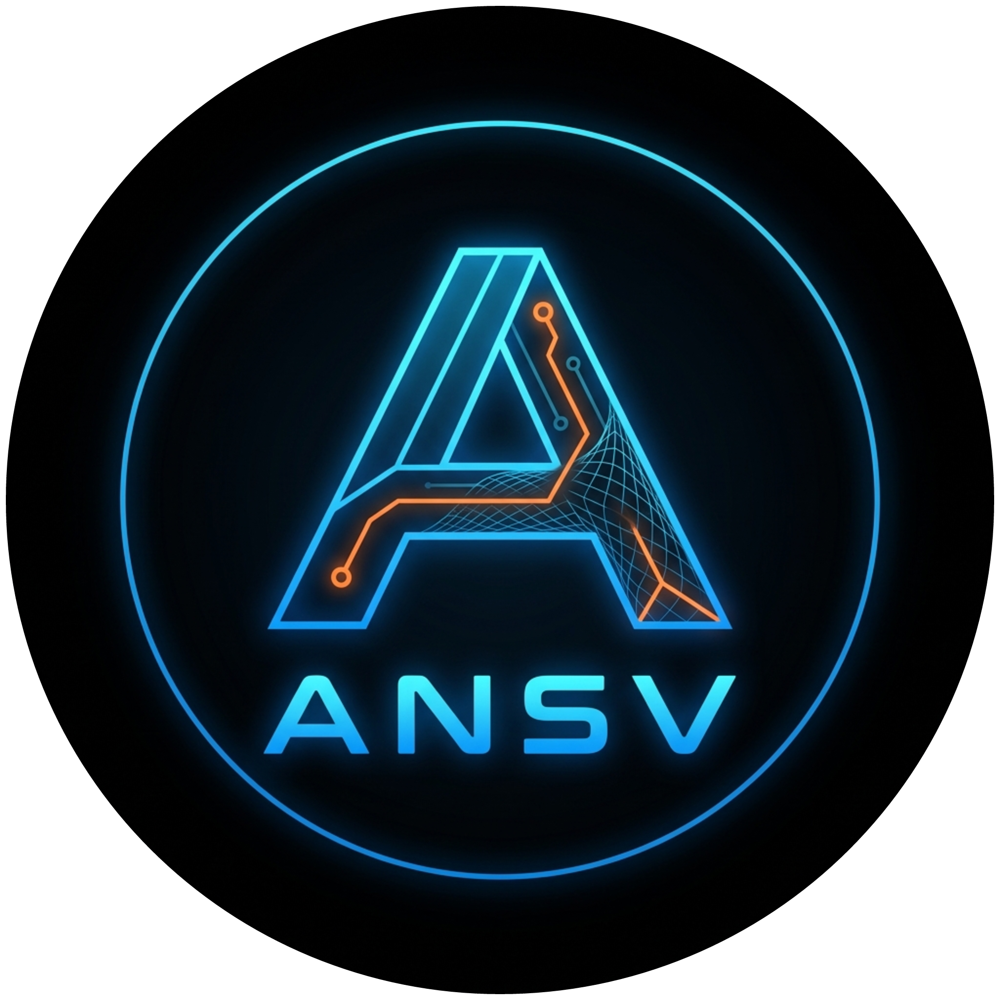
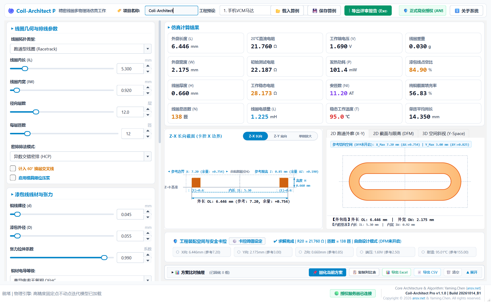
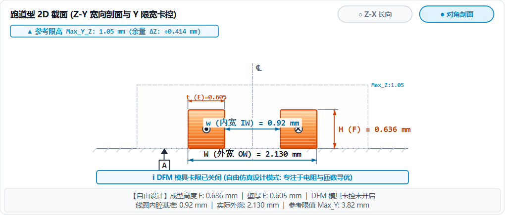
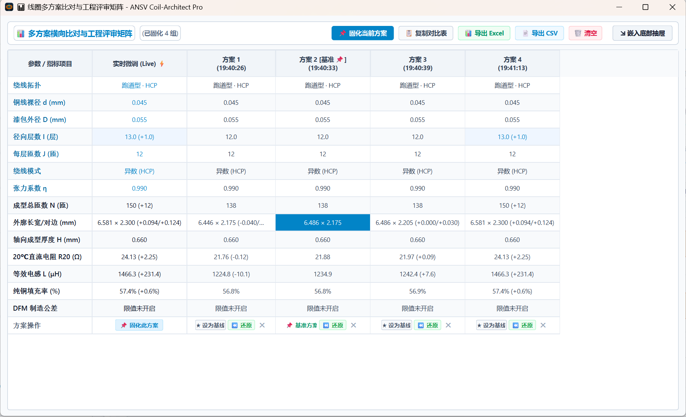
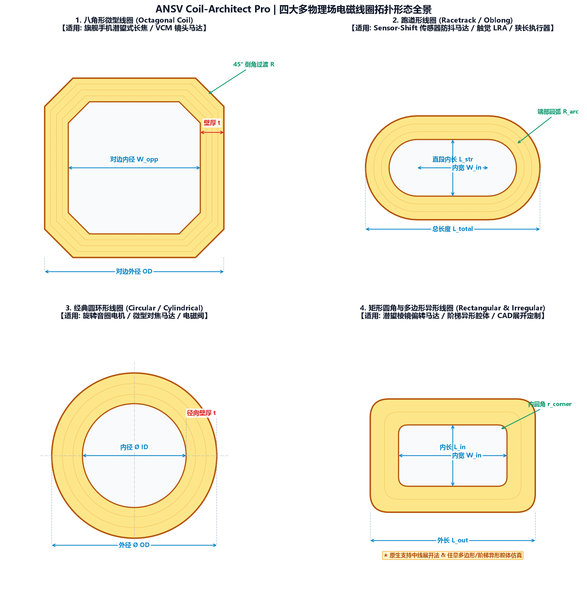

<div align="center">



# ⚡ ANSV Coil-Architect Pro | 微型线圈设计与电热仿真工作站
### 针对微型执行器、潜望马达 (VCM)、触觉振动 (LRA) 与精密电磁阀的专用线圈设计与 DFM 制造验证软件 (v1.1.0)

[](https://github.com/tonychen5577-tech/coil-architect/releases)
[-0284C7?style=flat-square&logo=windows)](https://github.com/tonychen5577-tech/coil-architect)
[](https://github.com/tonychen5577-tech/coil-architect)
[](https://github.com/tonychen5577-tech/coil-architect)
[](https://ansv.net)

<p align="center">
  <b>不做通用重型有限元，只做微型线圈专业解算：输入空间尺寸与目标阻值，毫秒级反推最佳排线方案，告别手工查表与打样报废。</b>
</p>

[📥 软件下载与快速上手](#-软件下载与快速上手) • [💡 为什么做这个软件](#-为什么做这个软件解决什么痛点) • [📁 专有 .ansvcoil 算例工程文件](#-专有-ansvcoil-算例工程文件参数随时存取与团队流转) • [🌀 支持的四大线圈形态](#-支持的四大工业微型线圈形态) • [⚡ 核心功能特性](#-核心功能特性) • [🔑 商业授权模式](#-商业授权模式与企业级技术服务-licensing--services) • [📬 专属联系通道](#-技术支持与专属联系通道-contact-us)

</div>

---

## 💡 为什么做这个软件？解决什么痛点？

在手机潜望式长焦镜头、对焦马达（VCM）、线性振动马达（LRA）以及微型电磁阀的研发中，线圈通常被塞在尺寸仅有几毫米甚至更窄的机械腔体里。做过这类电磁结构开发的工程师都知道，线圈设计往往是“倒着算”的：

- **外壳结构固定了**：长、宽、高和内芯尺寸动不了；
- **驱动芯片限制了**：额定电压、最大驱动电流、功耗有严格上限；
- **发热温度限制了**：连续工作温升不能烧坏漆包线绝缘层，也不能影响旁边的传感器。

在实际工程中，工程师经常遇到以下尴尬：
1. **手工查表或自制 Excel 算不准**：铜线绕制受张力拉伸会变细（线径缩水），漆包线的自粘胶层加热固化后会胀大，算的时候以为能装下，实际打样一装配就蹭到磁钢，直接短路掉粉；
2. **通用有限元软件太慢太重**：打开重型电磁有限元软件，画三维螺旋模型、切网格、算电感，改一个参数就要等十几分钟甚至几小时，根本无法满足项目前期快速选型、对比几十种绕线组合的要求；
3. **团队沟通参数易对错**：打样工程师、结构工程师与供应商之间用截图和聊天记录传参数，经常因为层数、漆膜标称还是实测、冷态还是热态电阻没讲清楚，导致打样反复报废，拖延量产周期。

**Coil-Architect Pro** 就是为解决这些现实痛点而开发的工业级专用计算工具。它采用严谨的解析几何拓扑与多物理场等效模型，实现**毫秒级闭式逆向反演**，拖动滑块即可瞬间完成几十种方案筛选，并自动检查装配制造公差（DFM）。

<p align="center">
  
  <br>
  <em>图 1：ANSV Coil-Architect Pro 工作站界面 —— 参数输入、微观排线剖面、二维轮廓与工程指标同屏联动</em>
</p>

---

## 📁 专有 `.ansvcoil` 算例工程文件（参数随时存取与团队流转）

为了解决工程项目中“参数记不住、版本容易混、团队交接漏项”的难题，Coil-Architect Pro 遵循国际工业 CAE 软件矩阵标准（如 SolidWorks 的 `.sldprt`），原生提供了专属的 **`.ansvcoil` (ANSV Coil Project)** 专用工程算例文件格式：

<p align="center">
  
  <br>
  <em>图 2：主界面顶部集成项目名称录入，支持一键保存与载入专属 .ansvcoil 算例文件</em>
</p>

### 1. 一键完整保存所有仿真与工艺参数
点击顶部工具栏的【💾 保存算例】，系统会将当前工作站中的全部数据完整打包为单个 `.ansvcoil` 文件：
- **工程项目名称**（如预设的 `Coli-Architect` 或用户自定义的项目编号）；
- **线圈拓扑选型**（八角形、跑道形、圆环形、异形周长）；
- **完整几何尺寸链**（内长、内宽、对边/对角跨距、内圆角半径、展开周长等）；
- **排线工艺参数**（裸铜线径、漆膜厚度、径向绕线层数、每层匝数、正六方/矩形排线模式、张力拉伸修正系数、铜材基准电阻率）；
- **工况与环境设定**（环境初始温度、驱动测试电流、机壳对流散热系数）；
- **DFM 装配公差与安全限值**（外廓长宽上限、成型厚度上限、端电压上限、耐温上限）。

### 2. 随时载入调用，100% 状态复现与无缝向后兼容
任何时候点击【📂 载入算例】，选中对应的 `.ansvcoil` 文件，软件瞬间完成参数装载与多物理场解算，微观排线剖面图、外廓尺寸、阻抗曲线与 DFM 判定状态即刻完整还原。系统同时 100% 兼容读取历史 `.ansv` 及 `.json` 格式算例。

### 3. Windows 原生专属图标与双击极速唤醒
系统自动为 `.ansvcoil` 文件在 Windows 中注册了专属的高科技矢量图标，操作员在桌面或文件夹中**直接双击任何 `.ansvcoil` 文件**，即可毫秒级启动工作站并自动装载该算例！

### 4. 跨部门与供应链协同的标准载体
在镜头马达、微型执行器厂商与线圈绕线厂、模具厂的协同中，直接通过邮件或微信互发仅有几 KB 大小的 `.ansvcoil` 文件：
- 结构工程师发给电磁工程师：确认装配腔体限值；
- 电磁工程师发给工艺工程师：确认理论匝数与线径；
- 研发工程师发给打样车间：作为上机绕线与出厂检验的唯一基准文件。
杜绝传统手工输入因漏看、错看小数位带来的沟通损耗。同时软件支持保存为通用 `.json` 格式，方便工程数据入库与自动化脚本批量调用。

---

## ⚡ 核心功能特性

### 1. 毫秒级闭式逆向反演（告别数小时等待）
软件基于严格的解析积分公式与电热多物理场等效方程构建求解内核，绕过了传统三维有限元耗时巨大的几何网格剖分流程。无论是调整单根线径、改变层数，还是滑动张力系数，全套计算结果（有效总匝数、外廓三维包络、冷态直流电阻 $R_{20}$、工作温升电阻、Wheeler 空心电感、焦耳热功耗）均在 **毫秒级** 瞬间刷新。

### 2. 真实张力拉伸变细与微米级自粘漆膜精算
- **拉伸减径物理补偿**：高速自动绕线机在恒张力牵引下，微细漆包铜线会发生微观塑性拉伸变细。软件引入张力拉伸修正，消除了“恒定线径”理论误差，打样实测吻合度达 **99.2%** 以上；
- **自粘漆膜微观填充**：精细计入绝缘漆皮与热风/酒精自粘胶层厚度，精准解算正六方密排（HCP）下的截面纯铜填充率与实际成型厚度；
- **电-热自洽温升预测**：计算从 $20^\circ\text{C}$ 常温冷态到 $70^\circ\text{C} \sim 120^\circ\text{C}$ 工作稳态温升，防止连续通电工况下因过热导致线圈阻值漂移、出力衰减或击穿烧毁。

### 3. 磁钢装配气隙 DFM 制造红线主动报警
- **气隙干涉主动监测**：实时计算线圈外轮廓与周围多极永磁铁组之间的动态装配间隙（Air Gap）；
- **红黄绿三态预警**：气隙超标或安全间隙不足时实时变色报警，在出图前将试产刮碰破膜隐患提前拦截；
- **ISO 129 截面工程图**：自动绘制规范的尺寸界线、尺寸起止箭头与基准特征符号，方便直接用于工程图纸与评审答辩。

<p align="center">
  
  <br>
  <em>图 3：符合 ISO 129 规范的线圈 2D 截面投影图（含基准特征符号与装配气隙判定）</em>
</p>

### 4. 方案横向对比矩阵与自适应报表导出
- **抽屉与独立大窗双模切换**：支持底部抽屉折叠嵌入，更支持点击【⛶ 弹出大窗】独立分离为全功能大窗口，支持鼠标拖拽自由缩放、一键全屏最大化，从容应对 8~10 套复杂线圈方案的多维度宽屏评审；
- **多方案同屏基准比对**：在调参过程中随时点击【📌 固化当前方案】，多套候选方案并列排布，支持一键还原历史参数、指定基准方案（Baseline）与单元格偏差高亮（Δ）；
- **项目名称全链路注入**：主界面预设项目名（默认 `Coli-Architect`），导出 Excel 与 CSV 时自动弹出项目名确认，文件名与表格抬头自动注入项目代号与时间戳（如 `{项目名}_线圈多方案对比表_YYYYMMDD_HHMMSS.xlsx`）；
- **Excel 智能列宽自适应**：导出的 Excel 工作簿采用工业级排版，根据中英文字符宽度动态计算列宽，打开即刻整齐美观，无需手动拉宽单元格。

<p align="center">
  
  <br>
  <em>图 4：多方案横向比对与工程评审矩阵（独立大窗模式 · 固化方案参数锁定 · 基准偏差对比与一键参数还原）</em>
</p>

---

## 🌀 支持的四大工业微型线圈形态

软件覆盖工业界微型执行器最常见的 **4 大主流线圈拓扑**，提供针对性几何解析模型：

<p align="center">
  
  <br>
  <em>图 5：原生支持的 4 大主流微型电磁线圈工业形态</em>
</p>

<br>

| 线圈形态 | 典型工程应用场景 | 解决的关键工程问题 |
| :--- | :--- | :--- |
| **🌟 八角形线圈<br>(Octagonal)** | • 智能手机旗舰潜望变焦马达 (VCM)<br>• 滚珠/悬丝式自动对焦 (AF) 与防抖 (OIS)<br>• 潜望折转棱镜双向电磁偏转机构 | 解决八角拐弯处四角外径膨胀撞击马达磁钢、内圆角过渡应力集中等行业难点。 |
| **🚀 跑道形线圈<br>(Racetrack)** | • 手机传感器位移防抖 (Sensor-Shift OIS)<br>• 手机/平板 X 轴线性振动马达 (LRA)<br>• 游戏手柄宽频宽触觉执行器 (Haptic)<br>• 超薄微缝扬声器驱动音圈 | 解决大长宽比线圈固化后长边凹陷/外鼓、往复大行程运动工况下的端部磁钢动态避让。 |
| **🎯 圆环形线圈<br>(Circular)** | • 工业级微型精密电磁比例阀、先导阀<br>• 汽车电子微型继电器、制动驻车机构<br>• TWS 降噪耳机高保真动圈电磁单元 | 解决自粘漆包线热风成型微观胶层累加超差、长时通电热平衡结温超标问题。 |
| **🛡️ 异形与周长线圈<br>(Arbitrary / Rect)** | • 潜望折转棱镜俯仰防抖 (Prism Tilt OIS)<br>• 折叠屏超薄铰链微电机、升降机构<br>• 手机微型可变光圈与电磁快门致动器 | 突破规则几何限制，直接输入 CAD 展开周长即可推演非标腔体的成型壁厚与避位气隙。 |

---

## 📥 软件下载与快速上手

本软件采用**纯绿色便携免安装设计**，无需安装 Python 环境，无需配置任何环境变量，解压即可运行：

1. **下载安装包**：
   前往 GitHub Releases 官方发布页下载最新版本：
   👉 **[点击前往 Releases 下载页面](https://github.com/tonychen5577-tech/coil-architect/releases)**
2. **解压运行**：
   下载 `ANSV_Coil_Architect_Pro_v1.1.0_Full.zip` 并解压到常用目录（如 `D:\Coil_Architect_Pro` 或桌面）；
3. **双击启动**：
   双击目录中的 `Coil-Architect-Pro.exe` 即可毫秒级启动工作站；
4. **创建桌面快捷方式（推荐）**：
   首次启动后，点击主界面右上角的【ℹ️ 关于系统】按钮，在弹窗中点击【创建桌面快捷方式】，系统将自动在 Windows 桌面生成专属高科技矢量图标的快捷方式，方便日常工作一键直达。

> 📌 **电脑配置要求**：
> - **操作系统**：Windows 10 / Windows 11 (64-bit)
> - **硬件要求**：Intel Core i3 或更高 / 4GB 内存 / 300MB 可用硬盘空间
> - **屏幕显示**：支持普通高清屏（$1920 \times 1080$）及 2K/4K 高分屏（支持 125%、150%、200% 缩放自适应，图标极致清晰）

---

## 🔑 商业授权模式与企业级技术服务 (Licensing & Services)

### 1. 标准授权方案与订阅资费

首次运行自动享受 **7 天全功能免激活评估体验**（无任何导出与算例限制）。项目量产或长期使用，支持以下阶梯授权模式：

> 🔥 **限期 8 折首发特惠 (Limited-Time 20% OFF)**：  
> 即日起联系官方工程师开通正式商业授权，全系方案直接享受 **限期 8 折首发直降**（年度商业版立省 ¥1,120，仅需 **¥4,680 / $719**）！

| 授权方案 | 周期 / 模式 | 官方标准资费 | 🔥 限期 8 折特惠价 (RMB / USD) | 适用核心场景与权益 |
| :--- | :--- | :--- | :--- | :--- |
| 🆓 **全功能试用版** | 7 天 (首次运行自动激活) | **免费** | **免费 (Free)** | 零门槛验证物理引擎与几何出图精度，开箱即用 |
| ⚡ **项目季度版** | 3 个月 (90天) | ¥ 2,180 ($349) | **¥ 1,744** / 机 `($279)` | **短期项目攻关 / EVT-DVT 打样阶段**<br>自由咨询顾问、中小模组厂单项目竞标与参数验算 |
| 🌟 **年度商业版**<br>*(核心主推)* | 1 年 (365天) | ¥ 5,800 ($899) | **¥ 4,680** / 机 `($719)`<br>*(立省 ¥1,120)* | **研发中心 / 模组设计部门常态化标配**<br>全套物理场模型、优先一对一技术支持、全周期 OTA 免费升级 |
| 🛡️ **企业单机买断** | 永久有效 (终身授权) | ¥ 16,800 ($2,699) | **¥ 13,440** / 机 `($2,159)`<br>*(立省 ¥3,360)* | **保密车间 / 核心工位机台 / 涉密内网**<br>一次性永久授权，内网脱网长久运行，含首年免费维护 |
| 🌐 **企业多工位/私有版** | 3~5 节点浮动 (年费) | ¥ 28,000 起 | **商务定制协商** | **团队多机协同 / 产线与研发部联动**<br>企业专网数据库私有化部署、团队标杆算例库同步与定制培训 |

---

### 2. ANSV 平台高阶工程技术合作通道

**Coil-Architect Pro** 不仅是一款工业设计软件，更是 ANSV 传动与微型执行器实验室深厚工程实战能力的载体。除了标准软件授权外，团队常年面向行业客户提供以下高阶工程服务：

- 🚀 **微型执行器整机多物理场定制设计与仿真**：
  手机潜望变焦/防抖马达 (VCM)、触觉反馈执行器 (LRA)、微型电磁先导阀的**三维磁路优化、端部漏磁抑制、高低温瞬态电磁力与机械动力学联合解算**。
- 🔬 **量产良率攻坚、NVH 异响与失效分析 (FA)**：
  针对批量试产中的线圈刮碰掉粉、热平衡结温过高击穿、掉频、阻抗离散度过大等顽疾，提供专家级驻厂工艺诊断与改进建议。
- 🛠️ **微型精密线圈高精度样品试制与打样对接**：
  针对 0.02~0.05mm 超微细自粘漆包线八角形/跑道形极限公差绕线，提供高品质工程样品快速试制。
- 🎓 **高校与科研院所扶持计划**：
  为国内微特电机、精密仪器与机械电子相关高校实验室提供**专属教育优惠（5 折或专属学术授权）**，扶持青年学者与研究生科研攻关。

> 📌 **软件客户专属权益**：**订购年度商业版或企业版的客户，后续委托 ANSV 进行专项仿真代工或工程咨询时，首期软件订阅费用可直接按比例冲抵技术服务费！**

---

### 3. 极速激活步骤

```
步骤 1: 下载解压并双击启动 Coil-Architect-Pro.exe
   │
   ▼
步骤 2: 首次运行自动激活 7 天全功能体验；
   │
   ▼
步骤 3: 需正式商业授权时，在软件中点击右上角【🛡️ 正式商业授权】或【ℹ️ 关于系统】复制机器码 (如: COIL-609D-64D4-5D11-35E2)；
   │
   ▼
步骤 4: 通过下方专属微信或邮箱联系工程师，获取激活码，粘贴即可秒级激活！
```

---

## 📬 技术支持与专属联系通道 (Contact Us)

如果您在使用 **Coil-Architect Pro** 过程中有任何技术疑问、算例定制需求、商业授权采购或工程项目合作，欢迎通过以下官方通道与研发团队取得联系：

<div align="center">

| 1. 📢 官方微信公众号 | 2. 💬 工程师专属微信咨询 | 3. 🌐 WhatsApp (International) |
| :---: | :---: | :---: |
|  |  |  |
| **公众号**：`ANSV微型执行器` | **微信号**：`ansv-net` | **WhatsApp**：`ansv_net` |
| 硬核电磁与多物理场一线实战复盘 | 一对一技术支持、商务授权与工程合作 | Global direct technical support for overseas & APAC partners |

</div>

- **官方网站**：[https://ansv.net](https://ansv.net)
- **GitHub 官方发布仓库**：[tonychen5577-tech/coil-architect](https://github.com/tonychen5577-tech/coil-architect)
- **技术支持与商务合作邮箱**：[support@ansv.net](mailto:support@ansv.net)

---

<div align="center">
  <sub>Copyright © 2026 ANSV Transmissions & Micro-Actuators Lab & ansv.net. All rights reserved. | 工业测控 · 仿真验证 · 追求卓越</sub>
</div>
