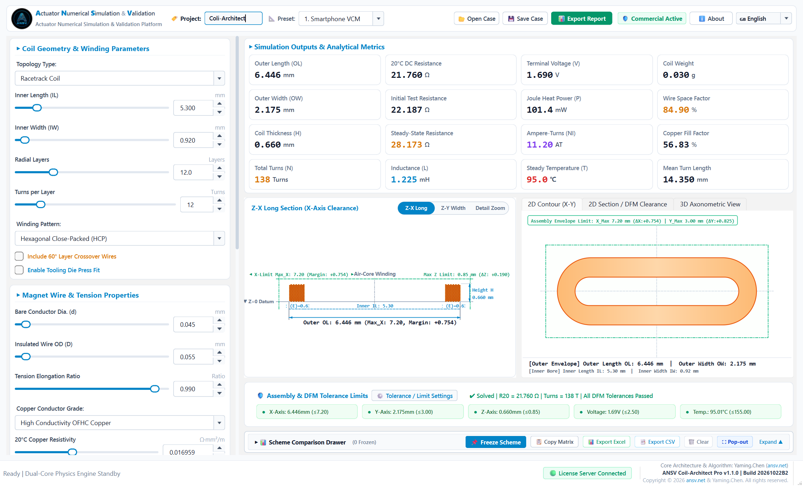

<div align="center">

<p align="right">
  <b>Language:</b>
  <a href="README.md">🇨🇳 简体中文</a> |
  <a href="README_EN.md"><b>🇬🇧 English</b></a>
</p>


# ⚡ ANSV Coil-Architect Pro | Micro Coil Design & Simulation Workstation
### Specialized Micro Coil Geometry Design, Electro-Thermal Simulation & DFM Verification Workstation for Micro Actuators, VCM, LRA & Precision Solenoids (v1.1.0)

[](https://github.com/tonychen5577-tech/coil-architect/releases)
[-0284C7?style=flat-square&logo=windows)](https://github.com/tonychen5577-tech/coil-architect)
[](https://github.com/tonychen5577-tech/coil-architect)
[](https://github.com/tonychen5577-tech/coil-architect)
[](https://ansv.net)

<p align="center">
  <b>No heavy general-purpose FEA overhead — Dedicated strictly to micro coil physics: enter physical envelope constraints and target resistance to analytically solve optimal winding configurations in milliseconds.</b>
</p>

[📥 Download & Quick Start](#-download--quick-start) • [💡 Why Coil-Architect Pro?](#-why-coil-architect-pro-engineering-pain-points) • [📁 Proprietary .ansvcoil Project Format](#-proprietary-ansvcoil-project-files) • [⚡ Key Features](#-key-features) • [🌐 Bilingual Switcher](#-bilingual-switcher-chinese--english) • [🌀 Supported 4 Coil Topologies](#-supported-4-industrial-micro-coil-topologies) • [🔑 Licensing & Services](#-commercial-licensing--engineering-services) • [📬 Contact Us](#-technical-support--contact-channels)

</div>

---

## 💡 Why Coil-Architect Pro? Engineering Pain Points

During the development of periscope telephoto smartphone lenses, Voice Coil Motors (VCM), Linear Resonant Actuators (LRA for haptic feedback), and miniature precision electromagnetic valves, the coil is confined to extremely narrow mechanical cavities of only a few millimeters or less. Electromagnetic hardware development engineers understand that coil design is fundamentally an **inverse engineering problem**:

- **Rigid Mechanical Envelope**: Length, width, height, and bobbin/air core dimensions cannot be altered;
- **Strict Driver IC Limitations**: Maximum drive voltage, peak current, and power consumption are hard-capped;
- **Stringent Thermal Constraints**: Steady-state continuous Joule heat dissipation must never exceed the temperature rating of the bondable magnet wire insulation, nor interfere with adjacent CMOS image sensors.

In conventional engineering practice, development teams constantly face critical bottlenecks:
1. **Spreadsheets & Manual Tables Are Inaccurate**: High-speed winding tension stretches and thins magnet wire (plastic necking), while thermal bond layers expand during curing. Theoretical spreadsheet calculations often pass on paper, but physical prototypes interfere with permanent magnets upon assembly, leading to short circuits and insulation scraping;
2. **Heavyweight 3D FEA Is Too Slow**: Launching general-purpose electromagnetic finite element software to model 3D helical spirals, mesh millions of elements, and solve for inductance takes 20 to 60 minutes per iteration — completely impractical for evaluating dozens of winding permutations during preliminary prototyping;
3. **Cross-Departmental Miscommunication**: R&D, structural engineers, and coil winding vendors exchange parameters via chat messages and screenshots. Inconsistencies regarding nominal vs. actual wire OD, cold vs. hot steady-state resistance, and layer count result in scrapped prototyping batches and costly schedule delays.

**Coil-Architect Pro** is built specifically to overcome these challenges. Utilizing closed-form analytical geometric integration and coupled electro-thermal models, it provides **millisecond-level closed-form inverse solving**. Dragging a slider instantly filters dozens of design candidates while automatically validating Design for Manufacturing (DFM) clearances.

<p align="center">
  
  <br>
  <em>Figure 1: ANSV Coil-Architect Pro Workstation — Interactive parameter controls, micro-packing cross-section, 2D contour, and 16 KPI metric cards seamlessly synchronized</em>
</p>

---

## 📁 Proprietary `.ansvcoil` Project Files

To eliminate lost parameters, version confusion, and handover discrepancies, Coil-Architect Pro adheres to international industrial CAE software standards (analogous to SolidWorks `.sldprt`), providing a dedicated native **`.ansvcoil` (ANSV Coil Project)** binary case format:

<p align="center">
  
  <br>
  <em>Figure 2: Top toolbar with project code entry, one-click saving, and loading of native .ansvcoil case files</em>
</p>

### 1. One-Click Parameter Preservation
Clicking **[💾 Save Case]** packages all current workstation state parameters into a single `.ansvcoil` file:
- **Project Code & Name** (e.g., `Coli-Architect` or custom enterprise case numbers);
- **Coil Topology Selection** (Octagonal, Racetrack, Circular Ring, Arbitrary Contour);
- **Complete Geometric Dimension Chains** (Inner Length, Inner Width, Flat/Corner Spans, Corner Fillet Radii, Expanded Perimeter);
- **Winding Process Parameters** (Bare Conductor Diameter $d$, Insulated Outer Diameter $D$, Radial Layer Count $I$, Turns per Layer $J$, HCP vs. Square packing, tension elongation coefficient $\eta$, copper grade conductivity);
- **Operating & Ambient Conditions** (Ambient temperature $T_{\text{amb}}$, test drive current $I_{\text{drive}}$, convective heat transfer coefficient $h$);
- **DFM Clearances & Safety Limits** (Envelope max length, width, height, terminal voltage cap, insulation thermal class).

### 2. Instant Case Recall & Backward Compatibility
Clicking **[📂 Open Case]** instantly loads any `.ansvcoil` case. The physics engine evaluates all equations in milliseconds, restoring the micro-packing diagram, 2D contours, impedance curves, and DFM compliance flags. Legacy `.ansv` and `.json` files are 100% backward-compatible.

### 3. Windows Native Shell Integration & Double-Click Wake-Up
The system registers the `.ansvcoil` file type and high-resolution vector icon with Windows. Engineers can **double-click any `.ansvcoil` file** in Windows Explorer or desktop to wake up the workstation and load the project in milliseconds!

### 4. Supply Chain & Inter-Departmental Collaboration Standard
Instead of ambiguous screenshots, teams share compact `.ansvcoil` project files (a few kilobytes):
- Structural engineers send cavity envelopes to electromagnetic specialists;
- Electromagnetic engineers verify turns, inductance, and resistance;
- Process engineers and coil winding vendors load the file directly on machine controllers as the golden standard for production and QA testing.

---

## ⚡ Key Features

### 1. Millisecond Closed-Form Analytical Inverse Solver
The solver kernel is built upon closed-form analytical geometric integration and multi-physics equilibrium equations, bypassing time-consuming 3D finite element mesh generation. Modifying conductor wire gauge, layer counts, or tension coefficients updates all outputs (effective turns $N$, 3D bounding envelope, cold resistance $R_{20}$, hot steady-state resistance, Wheeler hollow-core inductance, and Joule heating power) in **under 5 milliseconds**.

### 2. High-Speed Tension Thinning & Micron-Level Bond Coat Calculations
- **Plastic Tension Necking Compensation**: High-speed automatic winding tension causes microscopic plastic draw thinning in ultra-fine magnet wire. The solver incorporates tension elongation correction, eliminating theoretical constant-diameter errors and achieving **>99.2% correlation with physical prototypes**;
- **Microscopic Self-Bonding Fill Factor**: Accurately accounts for enamel insulation and hot-air/alcohol-activated self-bonding adhesive layers, computing Hexagonal Close-Packed (HCP) pure copper cross-sectional space factors and final build thickness;
- **Coupled Electro-Thermal Temperature Prediction**: Evaluates temperature rise from $20^\circ\text{C}$ room ambient to $70^\circ\text{C} \sim 120^\circ\text{C}$ steady-state operation, preventing thermal resistance drift, force degradation, and insulation breakdown.

### 3. DFM Assembly Clearances & Multi-Pole Magnet Air Gap Warnings
- **Dynamic Air Gap Surveillance**: Computes real-time dynamic clearance between the coil outer boundary and adjacent multi-pole permanent magnets;
- **Tri-Color Safety Alarms**: Highlights interference or insufficient safety margins with visual warnings before tooling release, preventing prototype scraping;
- **ISO 129 Compliant Engineering Projections**: Automatically annotates extension lines, arrowheads, and datum features conforming to ISO 129 standards for direct design review presentation.

<p align="center">
  
  <br>
  <em>Figure 3: ISO 129 compliant 2D section projection with datum symbols and assembly air gap clearance assessment</em>
</p>

### 4. Multi-Scheme Review Matrix & Adaptive Report Export
- **Dual Drawer & Standalone Window Modes**: Operates as a collapsible bottom drawer or detaches into a resizable standalone review matrix window via **[⛶ Pop-out]**, allowing full-screen widescreen evaluation of 8 to 10 competing coil proposals;
- **Side-by-Side Baseline Comparison**: Click **[📌 Freeze Scheme]** to capture candidate proposals into dedicated comparison columns. Supports one-click parameter recall, designating baseline schemes, and highlighting cell-by-cell delta deviations ($\Delta$);
- **Project Code Auto-Injection**: Project names (default `Coli-Architect`) are automatically injected into exported Excel and CSV filenames and sheet headers (e.g., `{ProjectID}_Coil_Comparison_Matrix_YYYYMMDD_HHMMSS.xlsx`);
- **Dynamic Excel Column Widths**: Exported workbooks dynamically format column widths based on text lengths, providing ready-to-share executive reports without manual cell adjustments.

<p align="center">
  
  <br>
  <em>Figure 4: Horizontal Scheme Comparison & Engineering Review Matrix (Pop-out window mode · Frozen scheme locking · Baseline delta tracking & One-click parameter restoration)</em>
</p>

---

## 🌐 Bilingual Switcher (Chinese / English)

To facilitate global research collaboration, multinational engineering handovers, and technical communication with overseas clients, **ANSV Coil-Architect Pro** integrates a native responsive Internationalization (i18n) engine:

<p align="center">
  
  <br>
  <em>Figure 5: ANSV Coil-Architect Pro Full English Workstation — Standardized industrial terminology, 16 KPI metric cards, and English engineering report export</em>
</p>

### 1. Intuitive Top Toolbar Language Toggle
- Positioned at the far right of the top navigation bar: `[ 🇨🇳 简体中文 | 🇬🇧 English ]`;
- **Instant Millisecond Dynamic Reload**: No software restart required. Switching instantly re-translates window titles, left parameter panels, 16 KPI cards, 2D/3D viewport tabs, DFM tolerance indicators, and the scheme comparison matrix;
- **Zero Loss of Current Design Parameters**: Signal cascading is completely isolated during language changes, ensuring all active parameters and snapshots remain 100% intact.

### 2. Rigorous Professional Industrial Terminology
- English translations strictly adhere to IEEE, IEC, ASTM, and SolidWorks industrial naming conventions;
- Standard physical symbols and subscript notations ($R_{20}$, $\mu\text{H}$, $\Omega$, $mm$, $\text{DFM}$, $\text{HCP}$, etc.) are preserved without machine translation ambiguity;
- Seamless linkage with licensing & international channels: switching to English automatically sets the licensing wizard to international mode with USD pricing and WhatsApp support.

### 3. Persistent Local User Preference
- Language preferences are automatically persisted to local AppData configuration (`app_config.json`). The workstation automatically remembers and boots into your preferred language on every launch.

---

## 🌀 Supported 4 Industrial Micro Coil Topologies

Coil-Architect Pro supports four core micro electromagnetic coil architectures:

<p align="center">
  
  <br>
  <em>Figure 6: Four primary micro electromagnetic coil topologies natively supported</em>
</p>

<br>

| Coil Topology | Typical Engineering Applications | Key Solved Challenges |
| :--- | :--- | :--- |
| **🌟 Octagonal Coil<br>(VCM AF / OIS)** | • Flagship smartphone periscope zoom VCM<br>• Ball-guided / wire-suspended autofocus (AF) & OIS<br>• Periscope prism tilt electromagnetic deflection | Solves corner build expansion collision with motor permanent magnets and corner transition stress concentrations. |
| **🚀 Racetrack Coil<br>(Haptic LRA)** | • Sensor-Shift optical image stabilization<br>• Smartphone & tablet X-axis Linear Resonant Actuators<br>• Game controller wideband haptic actuators<br>• Ultra-thin micro-speaker voice coils | Resolves long-edge inward sagging or outward bulging after curing, and dynamic magnet clearance during large-stroke travel. |
| **🎯 Circular Ring Coil<br>(Precision Solenoids)** | • Precision miniature proportional and pilot valves<br>• Automotive micro-relays and electronic parking brakes<br>• TWS earphone dynamic acoustic drivers | Solves cumulative bond layer tolerance stack-up during hot-air bonding and continuous thermal equilibrium overheating. |
| **🛡️ Arbitrary Contour<br>(CAD Contour / Rect)** | • Prism tilt periscope OIS actuators<br>• Foldable phone hinge micro-motors & sliders<br>• Micro variable aperture and electromagnetic shutters | Transcends rigid geometric shapes; allows direct entry of CAD expanded perimeter to compute build thickness and air gaps in custom cavities. |

---

## 📥 Download & Quick Start

Coil-Architect Pro is engineered as a **completely standalone, green portable deployment**. No Python environment, external compilers, or administrative installation is required:

1. **Download Package**:
   Visit the official GitHub Releases page:
   👉 **[Go to GitHub Releases](https://github.com/tonychen5577-tech/coil-architect/releases)**
2. **Extract**:
   Download `ANSV_Coil_Architect_Pro_v1.1.0_Full.zip` and extract to any folder (e.g., `D:\Coil_Architect_Pro` or Desktop);
3. **Run**:
   Double-click `Coil-Architect-Pro.exe` to launch the workstation in milliseconds;
4. **Desktop Shortcut (Recommended)**:
   Click **[ℹ️ About]** in the top right toolbar, then click **[Create Desktop Shortcut]** to generate a native vector-icon shortcut on your Windows desktop.

> 📌 **System Requirements**:
> - **Operating System**: Windows 10 / Windows 11 (64-bit)
> - **Hardware**: Intel Core i3 or equivalent / 4GB RAM / 300MB available storage
> - **Display**: Supports standard FHD ($1920 \times 1080$) and 2K/4K high-DPI displays (125%, 150%, 200% scaling adaptive with crisp vector assets)

---

## 🔑 Commercial Licensing & Engineering Services

### 1. Licensing Tiers & Pricing

Every first launch includes an automatic **7-day full-feature trial evaluation** with zero export or calculation restrictions. For ongoing R&D and production deployment, the following subscription and perpetual tiers are available:

> 🔥 **Limited-Time 20% OFF Launch Promotion**:  
> Contact our engineering team today to receive an immediate **20% direct discount** on all commercial tiers (Annual Commercial Tier saves $180, available at **$719 / ¥4,680**)!

| Licensing Tier | Term / Mode | Official Standard | 🔥 Limited-Time 20% OFF | Target Applications & Included Benefits |
| :--- | :--- | :--- | :--- | :--- |
| 🆓 **Evaluation Trial** | 7 Days (Auto-activated) | **Free** | **Free** | Zero-barrier evaluation of physics accuracy and export capabilities |
| ⚡ **Quarterly Tier** | 3 Months (90 Days) | $349 (¥2,180) | **$279** / seat `(¥1,744)` | **Short-term R&D sprints / EVT-DVT prototyping**<br>Consulting support, single-project bidding, and rapid verification |
| 🌟 **Annual Commercial**<br>*(Most Popular)* | 1 Year (365 Days) | $899 (¥5,800) | **$719** / seat `(¥4,680)`<br>*(Save $180)* | **R&D departments & actuator engineering teams**<br>Full multi-physics suite, priority 1-on-1 support, free OTA updates |
| 🛡️ **Perpetual Offline** | Perpetual (Lifetime) | $2,699 (¥16,800) | **$2,159** / seat `(¥13,440)`<br>*(Save $540)* | **Confidential labs / secure intranet workstations**<br>Perpetual offline node-locked license, includes 1-year maintenance |
| 🌐 **Enterprise Multi-Seat** | 3~5 Floating Nodes | From $4,500/yr | **Custom Negotiation** | **Team collaboration / Multi-site production line linkage**<br>Private server synchronization, benchmark database, custom training |

---

### 2. ANSV Actuator Lab Engineering Services

Beyond software licensing, **ANSV Transmissions & Micro-Actuators Laboratory** provides comprehensive contract engineering and physical prototyping:

- 🚀 **Full-Machine Multi-Physics Design & Simulation**:
  3D magnetic circuit optimization, end-leakage suppression, and coupled transient electromechanical dynamic simulation for periscope VCMs, LRAs, and micro-solenoids.
- 🔬 **Production Yield Enhancement, NVH & Failure Analysis (FA)**:
  On-site process diagnostics and root-cause analysis for coil scraping, thermal insulation breakdown, resonance shift, and high resistance dispersion during mass production.
- 🛠️ **Ultra-Fine Micro-Coil Prototype Winding**:
  High-precision rapid sample fabrication using 0.02mm ~ 0.05mm ultra-fine bondable magnet wire for octagonal and racetrack limit-tolerance coils.
- 🎓 **University & Research Institute Grants**:
  Special **50% academic grants** for academic labs researching micro-motors, precision instruments, and mechatronics.

> 📌 **Software Subscriber Advantage**: **Clients subscribing to Annual or Enterprise tiers can credit their software subscription fees directly toward technical service fees when commissioning ANSV for custom simulation or consulting projects!**

---

### 3. Rapid Activation Process

```
Step 1: Download, extract, and launch Coil-Architect-Pro.exe
   │
   ▼
Step 2: Automatic 7-day full-feature trial begins immediately upon first launch;
   │
   ▼
Step 3: Click [🛡️ Commercial Active] or [ℹ️ About] in the top toolbar to copy your Machine Code (e.g., COIL-609D-64D4-5D11-35E2);
   │
   ▼
Step 4: Contact our engineers via WhatsApp, WeChat, or Email to receive your License Token and activate in seconds!
```

---

## 📬 Technical Support & Contact Channels

For technical questions, custom project inquiries, commercial purchasing, or engineering partnerships, reach our engineering team via the following channels:

<div align="center">

| 1. 🌐 WhatsApp (International) | 2. 💬 Dedicated Engineer WeChat | 3. 📢 Official WeChat Channel |
| :---: | :---: | :---: |
|  |  |  |
| **WhatsApp**: `ansv_net` | **WeChat**: `ansv-net` | **Account**: `ANSV微型执行器` |
| Direct global technical support for overseas & APAC partners | 1-on-1 technical consultation, licensing & project collaboration | Hardcore electromagnetic & multi-physics engineering reviews |

</div>

- **Official Website**: [https://ansv.net](https://ansv.net)
- **GitHub Repository**: [tonychen5577-tech/coil-architect](https://github.com/tonychen5577-tech/coil-architect)
- **Technical Support & Business Email**: [support@ansv.net](mailto:support@ansv.net)

---

<div align="center">
  <sub>Copyright © 2026 ANSV Transmissions & Micro-Actuators Lab & ansv.net. All rights reserved. | Industrial Metrology · Simulation & Validation · Engineering Excellence</sub>
</div>
